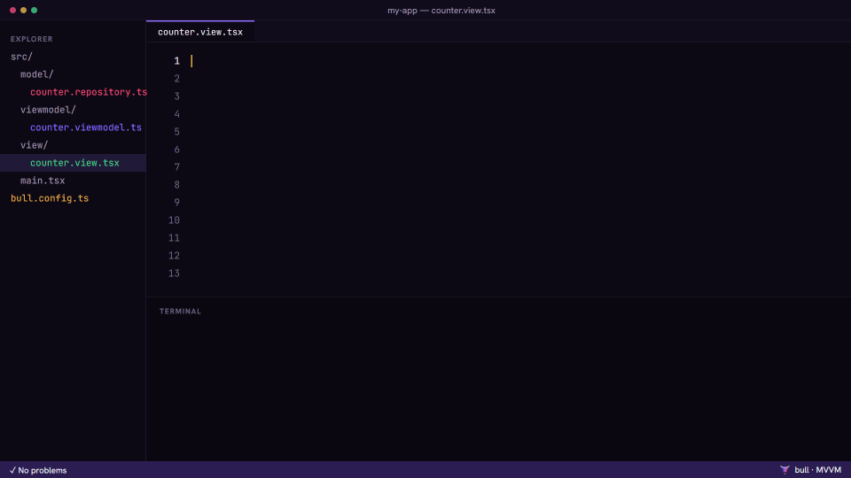

<p align="center">
  
</p>

<h1 align="center">Bull</h1>

<p align="center"><strong>Stubborn about architecture.</strong><br>
The opinionated React framework that refuses to build unless you respect MVVM.</p>

Bull is a React framework with a Vite/Next-style CLI (`bull dev`, `bull build`) and a twist: the
**Model–View–ViewModel** architecture is not a suggestion, it is part of the compiler. If a layer is
missing, if the View talks to the Model or if the ViewModel touches the DOM, the build stops. And it
does not stop with a cryptic error: it tells you what happened, why it breaks MVVM and how to fix it.

<p align="center"></p>

```bash
npm create @bull@latest my-app
```

<p align="center"></p>

```
── VIEW IMPORTS MODEL ───────────────────────────── src/view/label.view.tsx:2:1  MVVM100

  The View imports CounterRepository directly from the Model.

  1 │ import { useState } from "react";
  2 │ import { CounterRepository } from "../model/counter.repository";
    │ ^^^^^^^^^^^^^^^^^^^^^^^^^^^^^^^^^^^^^^^^^^^^^^^^^^^^^^^^^^^^^^^^

  The View only knows its ViewModel. If it talks to the Model directly, presentation
  logic gets tied to the UI: it can no longer be tested without React, and changing
  where the data comes from means touching components.

  How to fix:
    1. Move the use of CounterRepository to LabelViewModel (inject it through the
       constructor).
    2. Expose the data as state/computed and the actions as command.
    3. In the View, use useViewModel(...) and useBinding(...).

  More info: bull explain MVVM100
```

## Built on

- **Vite is the bundler.** Dev server, HMR and production builds are Vite. Bull analyzes the code
  before Vite runs and plugs the overlay in as a Vite plugin (`bullPlugin()`).
- **React draws the View.** Views are plain React components; `useBinding` sits on
  `useSyncExternalStore`.
- **Knockout had the idea.** MVVM came to the web with Knockout.js: observables, computeds and
  bindings. `state`, `computed` and `command` are that idea, typed and without data-binding
  attributes in the HTML.

## The enforced architecture

```
src/
├── model/       data and business rules        *.model.ts · *.repository.ts · *.service.ts · *.entity.ts
├── viewmodel/   screen state and actions        *.viewmodel.ts
├── view/        components that render          *.view.tsx
└── main.tsx     composition root: the only file that knows all three layers
```

| Layer | May import | Never |
|---|---|---|
| **View** | ViewModels, other Views, `@bull/runtime/react` | the Model, `useState`/`useEffect`, `fetch`, writing state |
| **ViewModel** | the Model, `@bull/runtime` | React, JSX, the DOM, direct I/O, exposing mutable state |
| **Model** | other Models, domain libraries | React, the reactive runtime, the DOM, upper layers |

Communication is strict too: the View **reads** with `useBinding(vm.x)` and **acts** with
`vm.command.execute()`. It never writes state.

```ts
// src/viewmodel/counter.viewmodel.ts
export class CounterViewModel extends ViewModel {
  readonly #count = this.state(0);          // private: only the ViewModel writes
  readonly count = this.#count.readonly;    // public: the View only reads
  readonly double = this.computed(() => this.#count.value * 2);
  readonly increment = this.command(() => this.#count.update((n) => n + 1));

  constructor(private readonly repo: CounterRepository) { super(); }  // injected
}

// src/view/counter.view.tsx
export function CounterView() {
  const vm = useViewModel(CounterViewModel);
  const count = useBinding(vm.count);
  return <button onClick={vm.increment.execute}>{count}</button>;
}

// src/main.tsx
createBullApp({
  root: CounterView,
  register: (c) => {
    c.model(CounterRepository, () => new CounterRepository());
    c.viewModel(CounterViewModel, (c) => new CounterViewModel(c.get(CounterRepository)));
  },
});
```

Because the ViewModel is a plain TypeScript class, it is tested without React or a DOM
([example](examples/todo-app/src/viewmodel/todo-list.viewmodel.test.ts)).

## Where the architecture linter runs

The rules exist once (`@bull/core`) and are enforced in four places, always with the same code and
message:

| | |
|---|---|
| `bull build` | Analyzes **before** calling Vite. On errors it exits with code 1 and produces no `dist/`. |
| `bull dev` | Re-analyzes on every change, prints the report in the terminal and shows it in a browser **overlay**. |
| `bull check [--format json]` | Analysis only, great for CI. |
| `@bull/eslint-plugin` | File-level rules underlined in your editor as you type. |

`bull explain MVVM201` (or `201`, or `view-owns-state`) prints the full explanation with
"don't / do" examples. Every rule is documented in [docs/rules](docs/rules/README.md).

## Tooling

```bash
npm create @bull@latest my-app # asks for the details, installs with your package manager, git init
bull init                      # adds Bull to an existing project, without overwriting anything
bull g feature shopping-cart   # repository + ViewModel (injected) + test + View, registered in main.tsx
bull g model user --kind repository
bull fix --dry-run             # safe codemods: renames, readonly state, type re-exports (shows a diff)
bull graph --format html --open  # interactive import graph, violating edges in red
bull graph --format mermaid    # paste it into your docs
bull doctor                    # Node, React, single React copy, config, tsconfig, ESLint, architecture
bull info                      # files per layer, each ViewModel's public API and who binds it
bull completion powershell     # shell completions (bash, zsh, fish, powershell)
```

| Command | What it does |
|---|---|
| `create` | New project from the template. Without a name it asks; `--pm`, `--no-install` and `--no-git` skip the questions. Also available as `npm create @bull`. |
| `init` | Adds `bull.config.ts`, the layer folders, the scripts and the dependencies to an existing project. Skips what exists; `--dry-run` shows the plan. |
| `generate` (`g`) | Scaffolds `feature`, `model` (`--kind model\|entity\|repository\|service`), `viewmodel` or `view` with the right names and folders. Never overwrites, supports `--dry-run`. |
| `fix` | Repairs what has a single correct answer: MVVM003 (rename + update imports), MVVM302 (privatize state, add `readonly`, make dependencies private), MVVM100 for type-only imports (re-export from the ViewModel). |
| `graph` | `tree`, `mermaid`, `dot`, `json` or a self-contained `html` page with a layered SVG layout. Exits 1 if an edge breaks the direction. |
| `doctor` | Environment and setup checklist with a hint for every problem. |
| `info` | Project summary, `--json` available. |
| `completion` | Completion script for `bash`, `zsh`, `fish` or `powershell`. |

`dev` and `build` also take `--mode` and `--config <file>`; `preview` takes `--open`, `--host` and
`--out-dir`.

## Rules

29 rules in 6 groups. **Structure** and **dependency direction** rules are the core of MVVM and
cannot be disabled: if `bull.config.ts` tries to, that is itself an error (MVVM900).

- **Structure**: required layers (001), no code outside the layers (002), naming convention (003), composition root (005).
- **Dependencies**: View ↛ Model (100), ViewModel ↛ View (101), Model ↛ upper layers (102), ViewModel/Model without React (103/104), no cycles (105).
- **View**: no I/O (200), no own state or effects (201), does not mutate the ViewModel (202), no business logic (203), no `new ViewModel` (204), no reactive primitives (205), no `.value` reads without binding (206).
- **ViewModel**: extends `ViewModel` (300), does not touch the DOM (301), does not expose mutable state (302), one per file (303), dependency injection (304), no direct I/O (305).
- **Model**: no reactive runtime (400), no DOM (401).

## Configuration

```ts
// bull.config.ts
import { defineConfig } from "@bull/cli";

export default defineConfig({
  dev: { overlay: "blocking" },            // or "dismissible" (default) or false
  rules: { MVVM203: "error" },             // configurable rules only
  view: { allowHooks: ["useState"] },      // purely visual state, if you want to allow it
  alias: { "@/": "src/" },
  vite: { server: { proxy: { "/api": "http://localhost:3000" } } },
});
```

## Packages

| Package | What it does |
|---|---|
| [`@bull/core`](packages/core) | Analysis engine: scanner, AST fact extraction (ESTree), import graph, rules and formatters. No dependency on Vite or ESLint. |
| [`@bull/runtime`](packages/runtime) | Home-grown signals (`state`, `computed`, `effect`, `batch`), `ViewModel`, `Command`, DI container and React bindings (`useViewModel`, `useBinding`). |
| [`@bull/cli`](packages/cli) | `dev / build / preview / check / explain / create / init` plus the tooling (`generate / fix / graph / doctor / info / completion`), Vite plugin and browser overlay. |
| [`@bull/create`](packages/create) | `npm create @bull`: the same `create`, as its own package. |
| [`@bull/eslint-plugin`](packages/eslint-plugin) | File-level rules as ESLint 9+ rules (flat config). |

**Key design decision:** rules do not look at the AST directly but at `ModuleFacts`, a summary of
the module (imports, hooks, globals, classes and their members…) extracted from any ESTree AST. The
build parses with `typescript-estree` and ESLint hands over the same format, so the editor and the
compiler run exactly the same code.

## Development

Node 20 or later (`.nvmrc` pins 22).

```bash
npm install
npm run build        # builds the five packages
npm test             # unit tests (runtime, core, eslint-plugin, cli, example)
npm run test:e2e     # build + tests of the binary against examples/ and fixtures/
npm run typecheck
npm run lint         # Biome: formatting, import order and lint (npm run format fixes it)
npm run docs         # regenerates docs/rules from the rule catalog

cd examples/todo-app && npm run dev
```

- `examples/todo-app`: reference app that builds cleanly.
- `fixtures/`: apps broken on purpose (missing layer, View talking to the Model…) that the build must reject.

### Releasing

Releases use [Changesets](https://github.com/changesets/changesets). A pull request that changes a
published package adds one with `npm run changeset`. On `main`, the release workflow opens a
"Version packages" pull request; merging it bumps the versions, writes each package's
`CHANGELOG.md` and publishes to npm with provenance. It needs an `NPM_TOKEN` secret with publish
rights on the `@bull` scope.

CI runs lint, typecheck, unit and e2e tests on Ubuntu and Windows with Node 20 and 22.

## License

MIT
